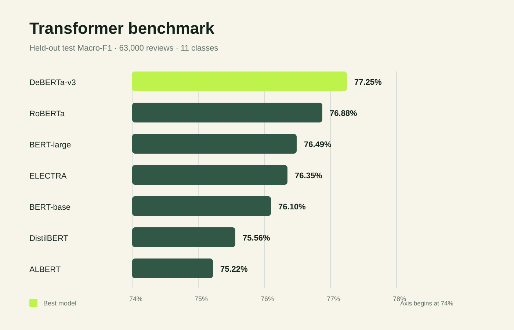

## Overview

Can the source of a shopping review be identified from its language alone? This project frames that question as an **11-class text-classification task** spanning global shopping platforms. Beyond maximizing accuracy, the work focuses on two risks that make the problem deceptively difficult: unequal class sizes and direct brand mentions that can leak the answer into the review text.

The final workflow combines reproducible data splits, leakage analysis, classical NLP baselines, class-imbalance experiments, and a shared Transformer evaluation pipeline. Across seven pretrained architectures, **DeBERTa-v3-base achieved the strongest test result: 0.7725 Macro-F1, 0.7716 accuracy, and 0.8893 Top-2 accuracy.**

## My Contribution

- Implemented the shared scoring workflow and reported accuracy, Macro Precision, Macro Recall, and Macro-F1.
- Built the word-frequency baseline and TF-IDF models using Logistic Regression and Linear SVM.
- Integrated brand-name masking and class-imbalance experiments into the evaluation workflow.
- Debugged the batch Transformer training and evaluation pipeline, standardized result collection, and preserved model-level outputs for comparison.
- Synthesized the findings into milestone reports and the final project presentation.

## Data and Task Design

The dataset contains **630,000 public shopping-app reviews** from 11 platforms. A stratified 80/10/10 split produced:

- **504,000** training examples
- **63,000** development examples
- **63,000** held-out test examples

Each record includes the review text, star score, helpful-vote count, timestamps, optional platform reply, and the source app label. Modeling intentionally centers on `content`; the goal is to learn platform-specific language rather than metadata shortcuts.

## Leakage-Aware Baselines

An audit found that roughly **29% of reviews explicitly mention an app or brand name**. That signal is useful in production but can make an academic benchmark artificially easy, so the baseline workflow evaluated both raw and masked review text.

The initial word-frequency method reached **0.3484 Macro-F1**. TF-IDF with Logistic Regression raised raw-text performance to **0.7021 Macro-F1**. Under brand masking, the baseline reached **0.5514 Macro-F1**, providing a more conservative reference point for imbalance experiments.

## Handling Class Imbalance

The largest label contained about seven times as many observations as the smallest. Two data-level SMOTE variants were compared with an algorithm-level class-weighting strategy over sparse TF-IDF features.

- Standard SMOTE: **0.5482 Macro-F1**
- Borderline-SMOTE: **0.5555 Macro-F1**
- Class-weighted Logistic Regression: **0.5802 Macro-F1**

Class weighting worked best because it changed the optimization objective without fabricating interpolated points in a sparse, high-dimensional text space.

## Transformer Benchmark

Seven pretrained encoders were fine-tuned under a shared configuration and evaluated by the same pipeline. This made model comparison reproducible across validation accuracy, Macro-F1, weighted F1, Top-2 accuracy, per-class metrics, and confusion matrices.

All seven models landed within a relatively narrow performance band. DeBERTa-v3-base led the benchmark, followed by RoBERTa-base and BERT-large. The compact DistilBERT model remained competitive, finishing only 1.69 percentage points behind DeBERTa in Macro-F1.

## What the Results Mean

The project produced three practical lessons:

1. **Evaluation design matters as much as architecture.** Direct brand mentions can inflate apparent performance, so masked and raw-text results should not be treated as interchangeable.
2. **Class weights fit sparse NLP features better than synthetic oversampling.** SMOTE's geometric interpolation was less effective in TF-IDF space.
3. **Larger models did not automatically win.** DeBERTa-v3-base outperformed BERT-large, while the seven Transformer results differed by only about two Macro-F1 points.

The final Transformer benchmark used the original review text, so it measures end-to-end platform recognition rather than a fully de-lexicalized test. A stronger next iteration would repeat the Transformer comparison on masked text, remove near-duplicate reviews across splits, and report repeated-seed confidence intervals.

## Engineering Deliverables

- One-command batch training and evaluation across seven Transformer architectures
- Shared label mapping and tokenization rules
- Automatic checkpoint discovery and standardized metric collection
- Validation and held-out test reporting with confusion matrices
- Separate baseline, leakage, and class-imbalance experiments

## Resources




